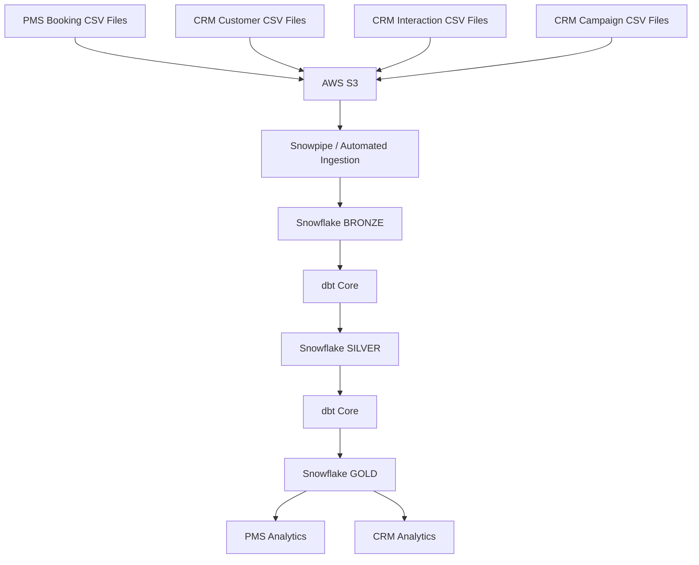

# Hotel Booking & CRM Data Engineering Platform

**AWS S3 | Snowflake | Snowpipe | dbt Core | SQL | Python**

An end-to-end cloud data engineering portfolio project demonstrating data ingestion, transformation, dimensional modelling, data quality validation, and analytics across hotel booking (PMS) and customer relationship management (CRM) datasets.

[](https://www.getdbt.com/)
[](https://www.snowflake.com/)
[](https://aws.amazon.com/)
[](https://github.com/sivasql35/ihcl-hotel-booking-data-platform)

---

## 1. Project Overview

This project demonstrates a cloud-based data engineering platform that integrates two business domains:

**Property Management System (PMS)**
- Hotel booking records
- Hotel and date dimensions
- Booking cancellation analytics
- Hotel-level business performance

**Customer Relationship Management (CRM)**
- Customer profiles
- Customer interactions
- Marketing campaign information
- Campaign delivery and engagement
- Customer segmentation and conversion analytics

The platform uses AWS S3 as a source-file landing zone, Snowflake as the cloud data warehouse, Snowpipe for automated ingestion, and dbt Core for SQL-based transformations and testing.

The data is organized using the Medallion Architecture: Bronze, Silver, and Gold.

**Project context:** This is an independently developed portfolio project using sample hotel-booking data and generated synthetic CRM datasets. It demonstrates hotel-industry business scenarios and is not IHCL's proprietary production platform or a representation of its internal systems.

## 2. Architecture

### High-level architecture



### Medallion architecture

| Layer | Responsibility |
|---|---|
| Bronze | Raw ingested source records with ingestion metadata |
| Silver | Cleaned, standardized, typed, and validated datasets |
| Gold | Business-ready facts, dimensions, customer views, and analytical marts |

## 3. Technology Stack

| Technology | Purpose |
|---|---|
| AWS S3 | Source-file landing and cloud storage |
| AWS IAM | Secure AWS-to-Snowflake access |
| Amazon SQS | Snowpipe event notification delivery |
| Snowflake | Cloud data warehouse |
| Snowpipe | Automated file ingestion |
| SQL | Data transformation and analytical modelling |
| dbt Core | ELT orchestration, model dependencies, and testing |
| Python | Synthetic CRM data generation and ingestion utilities |
| Git and GitHub | Version control and project management |

## 4. Data Sources

The project contains PMS booking data and synthetic CRM datasets.

| Dataset | Records |
|---|---:|
| PMS hotel bookings | 119,500 |
| CRM customers | 10,000 |
| CRM interactions | 25,000 |
| CRM campaign master | 25 |
| CRM campaign activities | 5,000 |

CRM source data is generated using Python scripts to create realistic customer, interaction, and campaign scenarios.

## 5. AWS and Snowflake Ingestion

### AWS S3

Created an S3 landing zone for source CSV files.

The PMS source prefix is:

```text
raw/pms/bookings/
```

Source files are retained for traceability and reprocessing.

### Snowflake integration

Configured secure access between AWS S3 and Snowflake using an IAM role and Snowflake storage integration.

The PMS implementation uses:

- Storage integration: `IHCL_INBOUND_INT`
- External stage: `IHCL_DB.BRONZE.IHCL_PMS_BOOKINGS_STAGE`
- CSV file format: `IHCL_DB.BRONZE.IHCL_PMS_CSV_FORMAT`

### Snowpipe

Implemented automated ingestion using Snowpipe and S3 event notifications through Amazon SQS.

The project includes dedicated Snowpipe ingestion pipelines for the PMS and CRM source datasets.

### Bronze layer

Raw records are stored in Snowflake with ingestion metadata.

Important metadata fields include:

- `SOURCE_FILE_NAME`
- `FILE_ROW_NUMBER`
- `FILE_LAST_MODIFIED`
- `INGESTION_TIMESTAMP`

These columns support source traceability, auditability, and data reconciliation.

## 6. Silver Layer – Data Transformation

The Silver layer standardizes and prepares source records for analytical modelling.

### PMS

Model: `SILVER_BOOKINGS`

Key transformations:
- Data type conversion and standardization.
- Date and numeric transformations.
- Derived arrival date.
- Total guest calculation.
- Total stay-night calculation.
- Technical booking key generation.
- Data-quality anomaly investigation.

A deterministic SHA-256 technical key is generated using the source filename and row number.

This identifies a source record and is not a real PMS reservation identifier.

### CRM

Four Silver models are implemented:

| Model | Description |
|---|---|
| `SILVER_CRM_CUSTOMERS` | Cleaned customer profiles |
| `SILVER_CRM_INTERACTIONS` | Customer interaction records |
| `SILVER_CRM_CAMPAIGN_MASTER` | Marketing campaign master records |
| `SILVER_CRM_CAMPAIGN_ACTIVITY` | Campaign delivery, engagement, and conversion events |

Key transformations include:
- Data standardization and type conversion.
- Null and duplicate handling.
- Customer and campaign relationship validation.
- Source metadata preservation.
- Preparation of clean datasets for downstream analytics.

## 7. Gold Layer – Business Analytics

The Gold layer contains analytical models designed around business requirements.

### PMS Gold models

| Model | Grain / Purpose |
|---|---|
| `DIM_HOTEL` | One row per distinct hotel and city combination |
| `DIM_DATE` | Continuous calendar date dimension |
| `FACT_BOOKINGS` | Booking-level fact records |
| `MART_HOTEL_PERFORMANCE` | Hotel-level performance metrics |

Business metrics include:
- Total bookings.
- Canceled and non-canceled bookings.
- Cancellation rate.
- Average Daily Rate (ADR).
- Average guests per booking.
- Total room nights.

### CRM Gold models

| Model | Grain / Purpose |
|---|---|
| `GOLD_CRM_CUSTOMER_360` | One row per customer, combining profile, interaction, and campaign metrics |
| `GOLD_CRM_ENGAGEMENT_SUMMARY` | One row per customer with interaction and engagement metrics |
| `GOLD_CRM_CAMPAIGN_PERFORMANCE` | One row per campaign with delivery, engagement, conversion, and ROI metrics |
| `GOLD_CRM_CUSTOMER_SEGMENTS` | One row per customer segment with customer and marketing performance metrics |

Key CRM analytical measures include:
- Total customer interactions.
- Average customer satisfaction.
- Interaction status and channel distribution.
- Campaign delivery and bounce counts.
- Opens, clicks, and conversions.
- Campaign conversion value and cost.
- Return on marketing spend (ROAS).
- Customer segment performance.

Aggregations are performed independently before joining customer-level measures to avoid unintended row multiplication.

## 8. Data Quality and Validation

dbt schema tests are implemented across PMS and CRM models.

Test types include:

- `not_null`
- `unique`
- `accepted_values`
- `relationships`

Validation also includes source-level reconciliation and business-rule checks.

### Final full-project build results

The complete project was executed using:

```bash
dbt build
```

**Actual execution results:**

| Metric | Result |
|---|---:|
| Table models built | 13 |
| Data tests executed | 60 |
| Successful operations | 73 |
| Failed operations | 0 |
| Warnings | 0 |
| Execution time | 19.67 seconds |

**Final result: 73/73 successful operations.**

### Data reconciliation highlights

| Validation | Expected / Observed |
|---|---:|
| PMS booking records | 119,500 |
| CRM customers | 10,000 |
| CRM interactions | 25,000 |
| CRM campaigns | 25 |
| CRM campaign activities | 5,000 |
| CRM campaign conversions | 159 |

Potential booking duplicates were investigated. Records were not automatically removed because the source data does not provide a reliable PMS reservation identifier to establish a defensible business key.

## 9. Project Structure

```text
ihcl-hotel-booking-data-platform/
│
├── crm_landing_to_raw.py
│
├── generate_crm_campaigns.py
├── generate_crm_customers.py
├── generate_crm_interactions.py
│
├── datasets/
│   ├── PMS/
│   │   └── bookings/
│   │
│   └── CRM/
│       ├── campaigns/
│       ├── customers/
│       └── interactions/
│
├── models/
│   ├── silver/
│   │   ├── silver_bookings.sql
│   │   ├── silver_crm_customers.sql
│   │   ├── silver_crm_interactions.sql
│   │   ├── silver_crm_campaign_master.sql
│   │   ├── silver_crm_campaign_activity.sql
│   │   └── schema.yml
│   │
│   └── gold/
│       ├── dim_date.sql
│       ├── dim_hotel.sql
│       ├── fact_bookings.sql
│       ├── mart_hotel_performance.sql
│       ├── gold_crm_customer_360.sql
│       ├── gold_crm_engagement_summary.sql
│       ├── gold_crm_campaign_performance.sql
│       ├── gold_crm_customer_segments.sql
│       └── gold_schema.yml
│
├── macros/
├── analyses/
├── seeds/
├── snapshots/
├── tests/
│
├── dbt_project.yml
└── README.md
```

## 10. Running the Project

### Prerequisites

- Python
- AWS CLI
- An AWS account with the required S3 and IAM permissions
- A Snowflake account
- dbt Core and the dbt Snowflake adapter
- Git

### Install dbt

```bash
pip install dbt-core dbt-snowflake
```

### Configure Snowflake

Configure your Snowflake connection in the local dbt `profiles.yml` file.

Do not commit credentials, passwords, private keys, or `.env` files to GitHub.

### Validate the connection

```bash
dbt debug
```

### Parse the dbt project

```bash
dbt parse
```

### Run all models and tests

```bash
dbt build
```

### Generate dbt documentation

```bash
dbt docs generate
```

### Serve documentation locally

```bash
dbt docs serve --port 8081
```

Note: AWS ingestion infrastructure and Snowflake objects must be configured before running the complete pipeline from source files.

## 11. Key Engineering Concepts Demonstrated

- Cloud data ingestion using AWS S3.
- Secure AWS IAM and Snowflake integration.
- Event-driven ingestion with Snowpipe and SQS.
- Bronze, Silver, and Gold Medallion architecture.
- SQL-based ELT using dbt Core.
- Deterministic SHA-256 technical keys.
- Dimensional modelling and fact/dimension relationships.
- Customer 360 analytical modelling.
- Marketing campaign performance analytics.
- Aggregation design and prevention of join multiplication.
- Data quality testing and referential integrity.
- Source-level traceability and audit metadata.
- Git-based source control.

## 12. Future Enhancements

Potential improvements include:

- Incremental dbt models for efficient batch processing.
- Automated orchestration and scheduled execution.
- CI/CD integration using GitHub Actions.
- Ingestion monitoring and alerting.
- Additional analytical marts.
- Dashboard integration with Power BI or Tableau.
- Automated source-to-target reconciliation.

## 13. Conclusion

This project demonstrates an end-to-end cloud data engineering platform covering hotel booking and CRM analytics.

It combines AWS S3, Snowflake, Snowpipe, Python, SQL, and dbt Core to demonstrate data ingestion, transformation, dimensional modelling, data quality validation, and business-oriented analytics.

The completed implementation includes 13 table models and 60 passing dbt data tests, with all 73 operations succeeding in the final full-project build.

---

**Repository:** [ihcl-hotel-booking-data-platform](https://github.com/sivasql35/ihcl-hotel-booking-data-platform)

**Author:** Sivananda Nadimidoddi